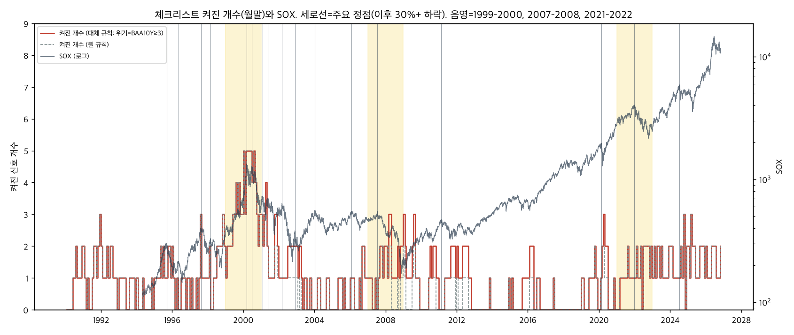
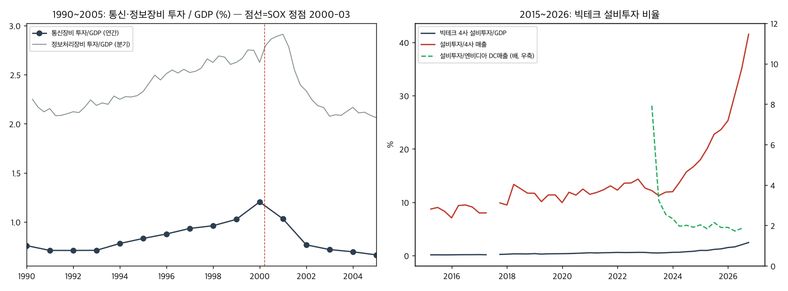

# 사이클 성숙도 분석 — 네 가지 계산의 평가 보고서

작성 2026-11-06. 제품 코드는 바꾸지 않았다. 스크립트는 `analysis/`, 중간 산출물은 `analysis/out/`, 외부 자료는 `analysis/data/`(출처는 `analysis/data/SOURCES.md`).

재실행:

```bash
uv run python analysis/fetch_data.py                      # FRED·EDGAR 내려받기 (.env의 FRED_API_KEY 사용)
uv run --with matplotlib python analysis/maturity.py      # 계산 1 (DB 필요)
uv run --with matplotlib python analysis/capex.py         # 계산 2
uv run python analysis/credit.py                          # 계산 3 (DB 필요)
uv run python analysis/cases.py                           # 계산 4 (DB 필요)
```

---

## 쉬운 설명

**무엇을 알아보려 했나.** "지금 AI 사이클이 과거 기술 버블의 어느 위치인가"를 매크로 지표로 읽을 수 있는지, 네 가지 도구 후보를 실제 데이터로 계산해 봤다. (1) 체크리스트 신호가 몇 개 켜졌는지를 눈금으로 삼는 성숙도 계기판, (2) 빅테크의 AI 설비투자를 매출과 견주는 과잉 건설 지표, (3) 회사채 스프레드로 보는 신용 단계, (4) 1997년형(조정 뒤 더 오름)과 1999년형(마지막 급등)을 가르는 신호 목록이다.

**계기판은 구축 가치가 낮다.** 1990년 이후 월말 442개를 평가했더니, 켜진 신호가 4개 이상이었던 달은 11개뿐이고 전부 1999-07~2001-03 한 사이클이다. 2007년 정점 앞에서는 최대 3개(그것도 정점 **뒤** 2008-02에, 바닥·위기 신호로), 2021년 정점 앞에서는 최대 2개였다. 즉 이 체크리스트는 "닷컴 끝물 탐지기"이지 사이클 성숙도 눈금이 아니다. 정점에 가까울수록 개수가 오르긴 하지만 약하다(주요 정점 0~3개월 전 평균 1.5개, 4년 넘게 전 0.6개. 순위상관 −0.21). 오늘은 8개 중 2개(CAPE 고평가, CCC 스프레드)가 켜져 "2~3개" 묶음인데, 그 묶음의 과거 결과(103개월, 54개 에피소드)는 전체 분포와 거의 같다. 2026-06 사상 최고가 당시에도 켜진 건 2개였다. **오늘의 눈금은 아무것도 말해 주지 않는다.**

**설비투자 지표는 "숫자는 선명하지만 분모가 없다".** 빅테크 4사(MSFT·GOOGL·AMZN·META) 분기 설비투자는 2026-09에 2,019억 달러(전년비 +108%)로, 4사 매출의 41.5%(2019년 10.7%), 미국 GDP의 2.45%(2019년 0.32%)다. 닷컴 때 통신장비 투자는 GDP의 0.78%(1994)에서 1.20%(2000)까지 6년간 1.5배 올랐는데, 이번은 7년간 7.7배다. 모양이 같지 않다(훨씬 가파르다). 문제는 "매출" 쪽이다. 엔비디아 데이터센터 매출로 나누면 2024년 이후 1.7~2.2배로 평평하다. 이것은 공급자 매출이라 설비투자와 같은 돈을 두 번 세는 셈이고, 광케이블 "이용률"에 해당하는 **AI 최종 고객 매출은 공개 통계가 없다**. 분기 1회 4개 숫자를 손으로 옮기는 수준이라 만들기는 쉽지만, 과잉 건설 판단은 못 한다. 구축 가치: 참고용 표 정도.

**신용 지표는 정점 탐지기가 아니라 붕괴 확인기다.** 무디스 Baa 회사채와 10년물 국채의 금리 차(BAA10Y: 기업이 국채보다 얼마나 비싸게 돈을 빌리는가)는 SOX 정점이던 2000-03에 2.09%p(역사 47번째 백분위), 2007-07에 1.59%p(12번째)로 평범했고, 위기가 터진 2002-10·2008-12·2020-03에야 3.9·6.2·4.3%p로 치솟았다. 오늘은 1.54%p(하위 8%)로 투자등급 시장은 조용하다. 반면 CCC(가장 약한 등급) 스프레드 12.97%p는 DB에 있는 3년 역사 안에서 98번째 백분위이고, 하이일드 전체 대비 3.9배(중간 2.9배)로 "꼬리만 벌 받는" 상태다. 2001·2008과 비교하려면 FRED의 CCC 전체 역사(1996-12~)를 DB에 더 받아야 한다(이번에는 안 했다).

**1997형 vs 1999형.** 두 날짜를 가른 신호는 5개(연준 인하, 일드 스프레드, 공모주 과열, CAPE, SOX 1년 급등)로 1999-12에 모두 켜졌고 1997-03에는 하나도 안 켜졌다. 오늘은 CAPE만 1999와 같고 나머지는 1997과 같거나(일드 스프레드 −1.0%p, SOX 1년 +41%) 데이터가 없다(공모주 2025-12까지). 단, 1999-12의 "연준 인하"는 Y2K 연말 실효금리 급락이 만든 가짜 신호다. 유사도 엔진 점수는 1997 창(0.354)이 1999 창(0.578)보다 지금과 닮았다고 하지만, 백테스트에서 이 매칭이 분포를 좁히지 못했으므로 참고일 뿐이다. 또 오늘은 두 날짜와 결정적으로 다르다. SOX가 2026-06-22 고점 대비 **−29.8%**로, 1997-03(−11%)이나 1999-12(0%)와 달리 이미 큰 조정 안에 있다.

**데이터가 말해 주는 것과 말해 주지 않는 것.** 말해 주는 것: 닷컴 끝물 특유의 "공모주 과열 + 1년 두 배 급등 + 주식이 채권보다 비쌈" 조합은 지금 없고(공모주는 미확인), 투자등급 신용은 조용하며, 설비투자 강도는 닷컴을 훨씬 넘는다. 말해 주지 않는 것: 이 설비투자가 과잉인지(AI 매출 분모 부재), 6월 고점이 사이클 정점이었는지(30% 기준으로 아직 미확정), 그리고 켜진 개수로 앞으로의 기간이나 낙폭을 좁힐 수 있는지(없다). 어떤 계산도 예측이 아니다.

---

## 계산 1 — 성숙도 계기판

**방법.** 1990-01~2026-10 매월 말에 `stocker.checklist.evaluate(date, …)`로 신호 9개를 평가(날짜 이하 데이터만 사용, 월간 시리즈는 45일 지연 — 룩어헤드 없음). "켜진 개수"는 데이터 없음을 제외하고 세고 분모(평가 가능 수)를 함께 기록했다. 위기 신호 2개(하이일드·CCC)는 2023-11 이후만 있어, FRED `BAA10Y`(1986~)로 `crisis_hy`를 대체한 열을 따로 두었다(임계 3.0%p; 아래 근거). 연준 인하 신호를 같은 달 20일 값으로 바꾼 "보정" 열도 두었다(아래 DFF 잡음).

**결과 변수(룩어헤드 있음, 표시·평가용).** 각 달에 대해 (a) 이후 24개월 안 SOX 최고 종가까지 개월 수와 그 최고가 이후 24개월 안 최대 낙폭, (b) 다음 "주요 정점"까지 개월 수. 주요 정점은 지그재그 방식으로 "그 고점에서 30% 이상 떨어져야 확정, 저점은 30% 이상 올라야 확정"(2007-07처럼 사상 최고가가 아닌 고점도 잡기 위해). 전체 역사에서 17개: 1995-09, 1996-05, 1997-08, 1998-02, 2000-03, 2000-06, 2001-01, 2001-05, 2002-03, 2002-11, 2004-01, 2006-01, 2007-07, 2011-02, 2020-02, 2021-12, 2024-07. (2000~2002 약세장 안의 30% 반등 고점도 포함된다.) 분위표에는 24개월 창이 완전히 지난 418개월(1990-01~2024-10)만 넣었다.

**BAA10Y 임계값 근거.** 위기별 최고치: 2002-10 3.90, 2008-12 6.16, 2020-03 4.31 → 3.0%p를 모두 넘는다. 3.0은 2012-06(3.46)과 2016-02(3.63)도 켜고, 전체 일수의 12.5%가 해당. 3.5면 2.9%(2012 제외). 1998-10 LTCM(2.77)과 2022-07(2.42)은 어느 쪽도 켜지 않는다.

### 켜진 개수 묶음별 결과 — 대체 규칙(BAA10Y), n=418개월

| 묶음 | 달 수 | 독립 에피소드 | 2년 내 최고가까지 개월(10/50/90%) | 최고가 이후 낙폭(10/50/90%) | 주요 정점까지 개월(50%) | 2년 안에 주요 정점이 안 온 달 |
|---|---|---|---|---|---|---|
| 0~1 | 304 | 49 | 3 / 18 / 24 | −66% / −35% / −10% | 17 | 40% |
| 2~3 | 103 | 54 | 2 / 17 / 24 | −73% / −40% / −14% | 17 | 37% |
| 4~5 | 11 | 5 | 0 / 2 / 5 | −75% / −73% / −72% | 3 | 0% |
| 6+ | 0 | 0 | – | – | – | – |

원 규칙·보정 규칙 표는 [analysis/out/maturity_buckets.md](../analysis/out/maturity_buckets.md). 월별 전체는 [analysis/out/maturity_monthly.csv](../analysis/out/maturity_monthly.csv). 4~5 묶음의 11개월은 전부 1999-07~2001-03(5개 에피소드지만 한 사이클)이라 낙폭 분위가 −72~−75%로 좁은 것은 표본이 하나라는 뜻이지 정밀하다는 뜻이 아니다.

### 주요 정점 전 개월 구간별 평균 개수 (대체 규칙)

| 정점까지 남은 개월 | 달 수 | 평균 개수 | 4개 이상 비율 |
|---|---|---|---|
| 0~3 | 52 | 1.52 | 12% |
| 4~6 | 31 | 1.68 | 10% |
| 7~12 | 56 | 1.02 | 4% |
| 13~24 | 83 | 0.87 | 0% |
| 25~48 | 70 | 1.03 | 0% |
| 49+ | 78 | 0.64 | 0% |

스피어만 순위상관(정점까지 개월 vs 개수, n=414) −0.21. 방향은 맞지만 약하다.

### 세 에피소드에서 개수는 어디까지 올라갔나

| 구간 | 최대 개수 | 그 달 | 그때 켜진 신호 | 주요 정점 |
|---|---|---|---|---|
| 1999–2000 | 5 | 1999-12 | 연준 인하(가짜, Y2K), 일드 스프레드, 공모주, CAPE, SOX 1년 급등 | 2000-03-10 |
| 2007–2008 | 3 | 2008-02 | 10년물 꺾임, 연준 인하, BAA10Y≥3 (모두 정점 7개월 **뒤**) | 2007-07-17 |
| 2021–2022 | 2 | 2021-07 | 10년물 꺾임, CAPE | 2021-12-27 |



**평가.**
- 단조성: 약하게 있다(위 표). 하지만 4개 이상은 닷컴 한 사이클에서만 나왔고, 2007·2021 정점은 "버블 끝·과열" 신호 없이 지나갔다. 정점 달의 켜진 개수(대체 규칙): 2000-03 5개, 2007-07 1개(10년물 꺾임), 2021-12 1개(CAPE), 2024-07 2개(10년물 꺾임, 장단기 역전).
- 거짓 경보(4개 이상인데 2년 넘게 주요 정점 없음): **0회 / 5에피소드**. 단, 5개 모두 1999~2001이라 "거짓 경보가 없다"는 말은 표본 1개에서 나온 것이다.
- 오늘(2026-11-04): 원 규칙 2/8(CAPE 40.99, CCC 12.97; 공모주 데이터 없음 — `IPO_FIRSTDAY`가 2025-12에서 끝나 지연 100일 규칙에 걸림), 대체 규칙 2/8(BAA10Y 1.54). 묶음 2~3의 과거 범위: 최고가까지 2~24개월(중간 17), 이후 낙폭 −73~−14%(중간 −40%). 0~1 묶음과 거의 같다. 최근 12개월 경로: 2026-04~06 고점 구간에서 2개(CAPE, SOX 1년 급등), 2026-07~09 1개, 2026-10 2개(CAPE, CCC).
- 데이터 결함: 실효연방기금금리(DFF)는 월말·연말에 일시적으로 튀어, "연준 인하" 신호가 월말에는 켜지고 같은 달 20일에는 꺼진 달이 39개다. 1999-12-31의 −1.72%p가 대표 사례. 제품 규칙 자체의 한계이며 이 보고서에서는 고치지 않았다(필요한 변경: `bottom_fed_cut`을 월평균이나 목표금리 `DFEDTARU` 기준으로 바꾸는 것을 제안).

---

## 계산 2 — AI 설비투자 대비 매출

**방법.** SEC EDGAR XBRL companyfacts(키 불필요, User-Agent 필요)에서 4사의 `PaymentsToAcquirePropertyPlantAndEquipment`(AMZN은 2016년 이후 `PaymentsToAcquireProductiveAssets`)와 매출 태그를 받았다. 현금흐름 항목은 회계연도 누적값이므로 분기화: 기간 100일 이하 행은 그대로, 긴 행(반기·3분기·연간)은 같은 시작일의 3개월 전 행을 뺐다. 같은 기간이 여러 공시에 있으면 최신 제출본. 8-K 제외. MSFT는 6월 결산이라 누적 시작이 7월이다. 분기 말은 달력 분기 말로 정규화. 엔비디아 데이터센터 매출은 보도자료 14건에서 수작업 표(`analysis/data/nvda_datacenter.csv`, 1·4·7·10월 말 분기를 한 달 앞 달력 분기에 맞춤). 룩어헤드 없음(공시 값), 공시 지연 약 1개월.

### 분기 표 (백만$, 최근 8분기; 전체는 [analysis/out/capex_quarterly.csv](../analysis/out/capex_quarterly.csv))

| 분기 말 | 설비투자 합 | 전년비 | 4사 매출 합 | 설비투자/매출 | 엔비디아 DC 매출 | 설비투자/DC매출 | 설비투자/GDP |
|---|---|---|---|---|---|---|---|
| 2024-12 | 72,339 | +68% | 402,278 | 18.0% | 35,600 | 2.03 | 0.97% |
| 2025-03 | 71,902 | +62% | 358,281 | 20.1% | 39,100 | 1.84 | 0.95% |
| 2025-06 | 88,246 | +67% | 388,087 | 22.7% | 41,100 | 2.15 | 1.15% |
| 2025-09 | 97,271 | +65% | 411,430 | 23.6% | 51,200 | 1.90 | 1.25% |
| 2025-12 | 118,632 | +64% | 468,381 | 25.3% | 62,300 | 1.90 | 1.51% |
| 2026-03 | 129,750 | +80% | 430,612 | 30.1% | 75,200 | 1.73 | 1.63% |
| 2026-06 | 165,050 | +87% | 471,210 | 35.0% | 89,000 | 1.85 | 2.03% |
| 2026-09 | 201,923 | +108% | 486,401 | 41.5% | – (11-17 발표) | – | 2.45% |

연간: 설비투자/매출 2019 10.7% → 2023 11.8% → 2024 16.1% → 2025 23.1% → 2026(3분기) 35.8%. 설비투자/GDP 2019 0.32% → 2026 2.04%.

### 1996~2001 비교군

FRED에 **분기·명목 통신장비 투자 시리즈는 없다.** 브리프의 `B935RC1Q027SBEA`는 "컴퓨터·주변기기"다. 쓴 것: 연간 명목 통신장비 투자 `C275RC1A027NBEA`(BEA 표 5.5.5, 1929~2025)와 분기 정보처리장비 투자 `Y034RC1Q027SBEA`(통신장비 포함 상위 항목). 통신업 매출 대리는 FRED에 없어 GDP 대비로 했다.

| 연도 | 통신장비 투자/GDP | 연도 | 통신장비 투자/GDP |
|---|---|---|---|
| 1994 | 0.78% | 1999 | 1.03% |
| 1995 | 0.83% | 2000 | **1.20%** |
| 1996 | 0.88% | 2001 | 1.03% |
| 1997 | 0.93% | 2002 | 0.77% |
| 1998 | 0.96% | 2003 | 0.72% |

정보처리장비 투자/GDP(분기) 정점 2000-12 2.91%.



**평가.**
- 모양: 다르다. 닷컴은 GDP 대비 6년간 +54%(0.78→1.20%)의 완만한 둔덕이고, 이번은 7년간 7.7배(0.32→2.45%)의 수직 상승이다. 4사 설비투자/GDP는 이미 닷컴 통신장비 전체의 정점(1.20%)의 두 배이고, 정보처리장비 전체 정점(2.91%)에 근접한다. 다만 분자 정의가 다르다(국민계정 산업 전체 vs 기업 4곳, 후자는 해외 투자 포함).
- 분모 문제: 엔비디아 DC 매출로 나눈 비율(1.7~2.2배)이 평평한 것은 "과잉이 아니다"가 아니라 공급자 매출이 설비투자와 같이 움직이기 때문이다(순환 참조). 4사 매출 대비 41.5%는 투자 강도를 보여 주지만 AI 매출이 아니다. 광케이블 이용률에 해당하는 "AI 최종 수요 매출"은 공개 통계가 없다(클라우드 AI 매출 run-rate는 실적 발표의 구두 언급뿐).
- 데이터 품질: EDGAR는 좋다(분기화 검증: 2026-09 4사 합 201,923 = MSFT 39,367 + GOOGL 51,355 + AMZN 77,259 + META 33,942). 엔비디아는 보도자료의 소수 1자리(±50백만$). 1990년대 비교군은 연간뿐.
- 분기 지연 약 1개월은 월간 체크리스트와 쓰기엔 문제없다.
- **구축 가치: 낮음~중간.** 분기 1회 EDGAR 자동 수집은 쉽고 설비투자 강도 자체는 유용한 맥락이지만, "과잉 건설" 판정을 내릴 분모가 없어 체크리스트 신호로 쓰기 어렵다. 만든다면 "설비투자/4사 매출"과 "설비투자/GDP" 두 줄을 참고 패널로만.

---

## 계산 3 — 신용 단계

[analysis/out/credit_tables.md](../analysis/out/credit_tables.md). BAA10Y 일간 1986-01-02~2026-11-03, n=10,210.

| 날짜 | BAA10Y(%p) | 그날까지 역사 백분위 | 전체 역사 백분위 | 비고 |
|---|---|---|---|---|
| 2000-03-10 | 2.09 | 69% | 47% | SOX 정점 |
| 2000-03-31 | 2.30 | 84% | 61% | |
| 2002-10-09 | 3.90 | 100% | 98% | 닷컴 붕괴 신용 최고 |
| 2007-07-17 | 1.59 | 16% | 12% | SOX 정점 |
| 2008-11-28 | 6.10 | 100% | 100% | |
| 2008-12-04 | 6.16 | 100% | 100% | 금융위기 최고 |
| 2020-03-23 | 4.31 | 98% | 98% | 코로나 최고 |
| 2026-11-03 | 1.54 | 8% | 8% | 최신 |

- CCC 이하 스프레드(DB 2023-11-06~2026-11-04, n=786): 최신 12.97%p, 3년 역사 안 98번째 백분위(최저 6.90, 중간 9.08, 최고 13.56 2026-10-23). 하이일드 전체 3.32%p(82번째). CCC/하이일드 비율 3.91배(중간 2.89, 최고 4.16).
- 해석: 투자등급·하이일드 전체는 조용한데 최약 등급만 벌 받는 구조. 2001·2008과 견주려면 FRED `BAMLH0A3HYC` 전체 역사(1996-12-31~)를 받아야 한다. DB에 2023-11 이후만 있는 것은 수집 범위 설정 때문이며 이 보고서에서는 바꾸지 않았다(필요한 변경: ingest 시작일 확장).
- 하이일드 발행 중 기술·AI 비중: 공개 무료 통계를 찾지 못했다. **수작업 필요.**

---

## 계산 4 — 1997형 vs 1999형

[analysis/out/cases_tables.md](../analysis/out/cases_tables.md), explain 원본 JSON `analysis/out/cases_explain_1997.json`, `…_1999.json`. 기준일 2026-11-04, 120거래일 창, 환경 우선(regime) 모드. then/now 값은 각 날짜 이하 데이터만 쓴다(expanding z-score).

| 항목 | 1997-03-31 | 1999-12-31 | 지금 |
|---|---|---|---|
| 고점 대비 낙폭 / 고점 이후 거래일 | −11% / 392 | 0% / 0 | −30% / 95 |
| 기준금리 DFF | 7.07 (z 1.2) | 3.99 (z −0.8, Y2K 연말 왜곡) | 3.88 (z 0.4) |
| 10년물 | 6.92 | 6.45 | 4.95 |
| 장단기 스프레드 | 0.47 | 0.21 | 0.32 |
| WTI | 20.4 | 25.8 | 99.6 (z 1.6) |
| VIX | 22.1 | 24.6 | 20.8 |
| 반도체 매출 YoY / 6개월 변화 | −17% / −1%p | +23% / +16%p | +144% / +79%p |
| 종합 점수(낮을수록 닮음) | 0.354 | 0.578 | |

| 체크리스트 | 1997-03-31 | 1999-12-31 | 2026-11-04 |
|---|---|---|---|
| 10년물 금리 꺾임 | ○ (0.0) | ○ (0.0) | ○ (−0.4) |
| 연준 금리 인하 | ○ (+1.6) | ● (−1.7, 가짜) | ○ (0.0) |
| 장단기 역전 | ○ (0.5) | ○ (0.2) | ○ (0.3) |
| 일드 스프레드 | ○ (−1.8) | ● (−3.0) | ○ (−1.0) |
| 공모주 첫날 수익률 | ○ (12.7) | ● (73.5) | – (2025-12까지만) |
| CAPE | ○ (28.3) | ● (40.6) | ● (41.0) |
| SOX 1년 급등 | ○ (+53%) | ● (+101%) | ○ (+41%) |
| 하이일드 / CCC | – / – | – / – | ○ (3.3) / ● (13.0) |

**가르는 신호(1997-03과 1999-12가 달랐던 것)**: 연준 인하(1999 ●, 가짜), 일드 스프레드(1999 ●), 공모주(1999 ●), CAPE(1999 ●), SOX 1년 급등(1999 ●). 오늘은 CAPE만 1999 쪽, 일드 스프레드·SOX 급등은 1997 쪽, 공모주는 미확인. 그리고 오늘은 두 날짜 어느 쪽도 아닌 "이미 −30% 조정 중, 반도체 매출 YoY +144%"라는 조합이다.

**이후 SOX 경로(표시용·룩어헤드)**

| 끝 날짜 | +6개월 | +12개월 | +24개월 | 24개월 내 최고 | 24개월 내 최저 |
|---|---|---|---|---|---|
| 1997-03-31 | +42% | +11% | +38% | +56% (1999-01) | −29% (1998-10) |
| 1999-12-31 | +62% | −18% | −26% | +89% (2000-03) | −50% (2001-10) |

두 사례 모두 6개월 뒤에는 크게 올랐고, 차이는 12~24개월 뒤에 났다. 표본 2개로는 어떤 규칙도 만들 수 없다.

---

## 한계 (공통)

- 모든 "정점까지 개월·이후 낙폭·이후 경로"는 미래 종가를 쓰는 결과 변수다. 신호 자체는 룩어헤드가 없다.
- 체크리스트는 1990년대 사례에서 거꾸로 만든 규칙이라 닷컴에서만 4개 이상 켜지는 것은 과적합의 흔적일 수 있다.
- SOX는 1994-05부터라 1990~1994 달에는 결과 변수가 없고 "SOX 1년 급등" 신호도 1995-05부터다. 주요 정점 수(17)는 30% 기준에 민감하다.
- 공모주 첫날 수익률이 2025-12에서 끝나 2026년 체크리스트에서 가장 중요한 "버블 끝" 신호 하나가 비어 있다.
- 설비투자 4사 ≠ 산업 전체, 엔비디아 ≠ AI 수요.

## 출처

- FRED: `BAA10Y`, `C275RC1A027NBEA`, `Y034RC1Q027SBEA`, `A679RC1Q027SBEA`, `GDP` (2026-11-06 내려받음, `analysis/data/fred_*.csv`).
- SEC EDGAR companyfacts: CIK 789019(MSFT), 1652044(GOOGL), 1018724(AMZN), 1326801(META) (2026-11-06, `analysis/data/edgar/`).
- 엔비디아 보도자료 14건 (`analysis/data/nvda_datacenter.csv`의 `source` 열).
- DB(기존): SOX 종가, FRED 매크로, 실러 CAPE·E/P, 공모주 첫날 수익률, WSTS.
